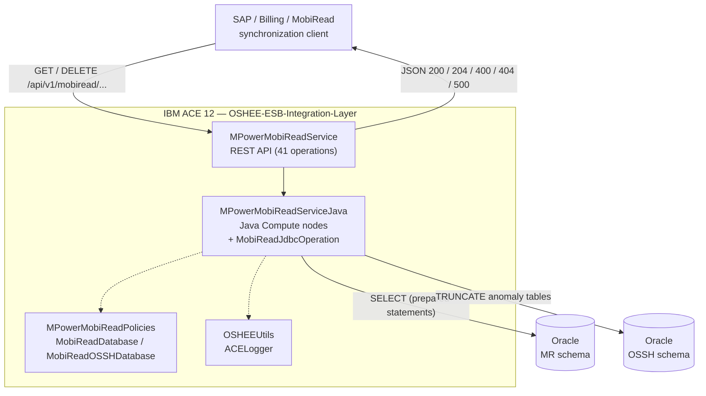
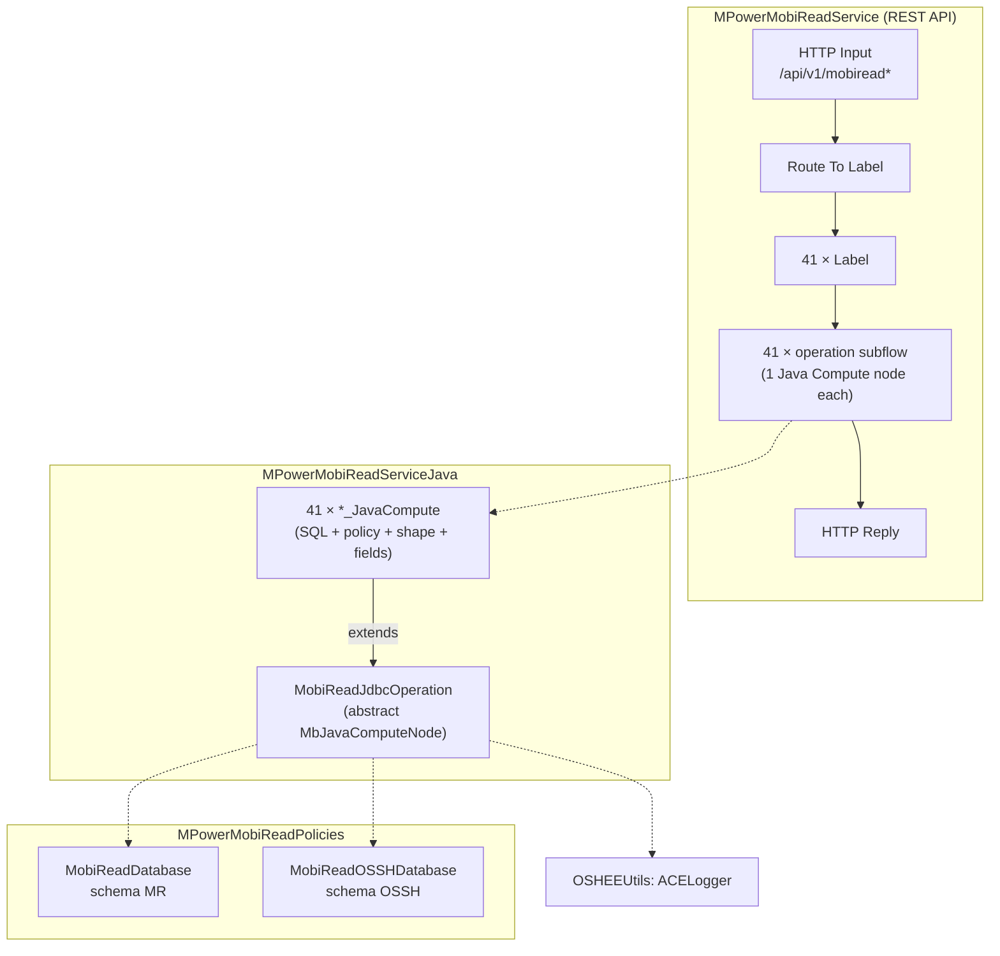
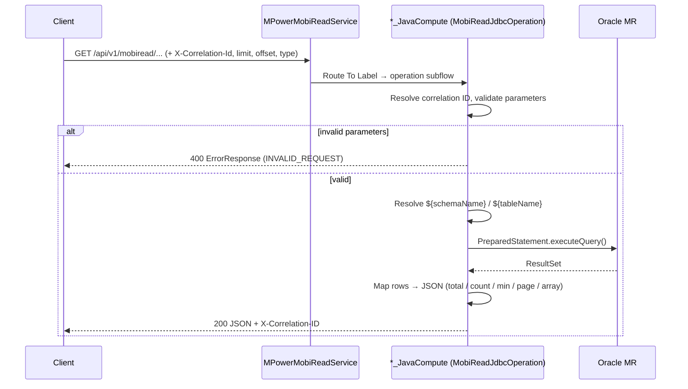
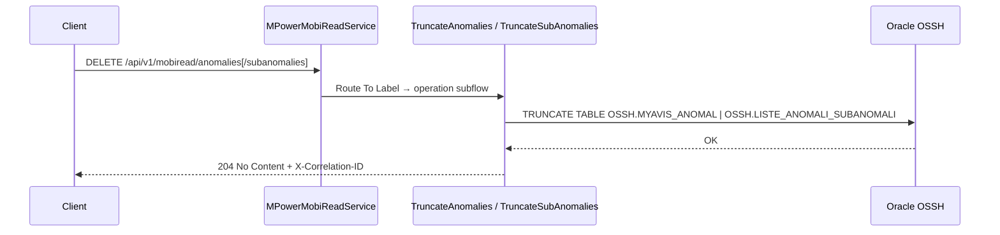
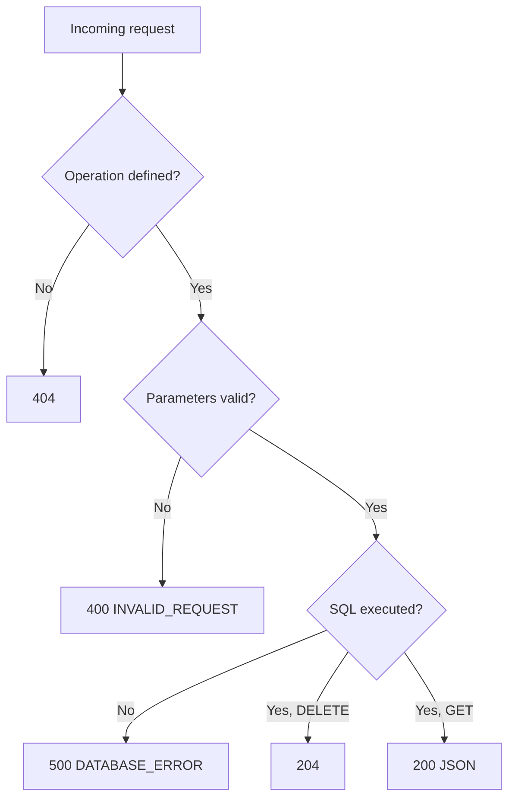

# Technical Solution: MPower MobiRead REST API Service (Oracle MR ↔ SAP / Billing)

| Field | Value |
|-------|-------|
| **Integration ID** | UC2 / INT-MPOWER-MOBIREAD-002 |
| **API title** | MOBIREAD Integration API |
| **API version** | 1.0.0 — OpenAPI 3.0.3 (`Mobiread UC2 - ACE corrected.yml`) |
| **Platform** | IBM App Connect Enterprise (ACE) 12 |
| **Direction** | Request / response: External systems (SAP, billing, MobiRead) → ACE → Oracle MR database |
| **Status** | Implemented — ESB Integration Layer |

---

## 1. Overview

### 1.1 Business purpose

OSHEE requires a controlled integration layer between the **Oracle MR (Meter Reading) database** and external systems (**SAP / billing** and the **MobiRead** mobile meter-reading solution). The service enables:

- Retrieval of consumers and meter readings pending synchronization
- Retrieval of reference data (zones, sub-zones, feeders, cabins)
- Clean-up of anomaly reference tables before reload
- Pre-import validation checks of consumer, reading and network data

Data is organised in four **logical data streams** — Fatura, Converge, Feed/HEC/Nenst and Special (Fideri16). SQL logic is taken from the **MOBIREAD Technical Analysis** (TA); query numbers in this document refer to that analysis.

### 1.2 Solution summary

The solution is delivered as an **IBM ACE REST API application**, composed of:

1. **MPowerMobiReadService** — REST API generated from the OpenAPI contract: one HTTP entry flow, 41 operation subflows.
2. **MPowerMobiReadServiceJava** — one Java Compute class per operation plus the shared base class `MobiReadJdbcOperation`.
3. **MPowerMobiReadPolicies** — JDBC policies `MobiReadDatabase` (schema `MR`) and `MobiReadOSSHDatabase` (schema `OSSH`).
4. **OSHEEUtils** — shared library for logging (`ACELogger`).

#### Architecture overview



### 1.3 Design principles

| Principle | Description |
|-----------|-------------|
| **Synchronous request / response** | Every operation is a single SQL statement executed synchronously; result is returned in the HTTP response. |
| **SQL as specified** | SQL statements are taken from the TA without changing business logic; only the schema prefix and placeholders are resolved by the service. |
| **No SQL from callers** | Table names, column names and SQL fragments are never accepted from callers. Logical type values (`fatura`, `converge`, `feed-hec-nenst`, `special`) are mapped server-side to a fixed whitelist. |
| **Bound parameters** | `limit`, `offset` and type number are bound to `PreparedStatement` parameters (`?`). |
| **Schema from configuration** | `${schemaName}` is resolved from the `databaseSchemaNames` property of the JDBC policy (`MR` / `OSSH`) and validated against `[A-Za-z][A-Za-z0-9_$#]{0,127}`. |
| **Transactional execution** | Connections use `JDBC_TransactionType.MB_TRANSACTION_AUTO`; the statement is committed / rolled back with the message flow transaction. |
| **Single generic engine** | All execution, mapping, validation, logging and error handling lives in `MobiReadJdbcOperation`; operation classes are declarative. |
| **Internal-only API** | No authentication on ACE; protection is expected at the API gateway if exposed externally. |

---

## 2. External interface

### 2.1 REST API

| Attribute | Value |
|-----------|-------|
| **Server base URL** | `/api/v1/mobiread` |
| **HTTP Input URL** | `/api/v1/mobiread*` (HTTP, `https=false`) |
| **Content-Type** | `application/json` (all responses with body) |
| **Fault format** | JSON |
| **Tags** | `Consumers`, `Readings`, `Zones`, `Anomalies`, `Feeders`, `Cabins`, `Utilities` |
| **Operations** | 41 — 39 × `GET`, 2 × `DELETE` |

**Headers**

| Header | Direction | Required | Description |
|--------|-----------|----------|-------------|
| `X-Correlation-Id` | Request | No | Propagated if present (CR/LF stripped); a UUID is generated if missing or empty. Matched case-insensitively. |
| `X-Correlation-ID` | Response | — | Always returned; same value used in ACE logs. |
| `Content-Type` | Response | — | `application/json` for every response with a body. |

**Common parameters**

| Parameter | In | Type | Constraints | Used by |
|-----------|----|------|-------------|---------|
| `limit` | query | integer | 1–14000, default `14000` | Paginated consumer / reading lists |
| `offset` | query | integer | ≥ 0, default `0` | Paginated consumer / reading lists |
| `type` | path | string | `fatura` \| `converge` \| `feed-hec-nenst` \| `special` | All `/utilities/{type}/...` operations |

#### 2.1.1 Logical type mapping

| `type` | Type No. (`typeNr`) | Header table (`${tableName}`) |
|--------|---------------------|-------------------------------|
| `fatura` | 1 | `MODOWNHEADER_FATURA_NEW` |
| `converge` | 2 | `MODOWNHEADER_CONVERGE_NEW` |
| `feed-hec-nenst` | 3 | `MODOWNHEADER_F_H_N_NEW` |
| `special` | 4 | `MODOWNHEADER_FIDERI16_NEW` |

#### 2.1.2 Endpoint catalogue

| # | Method | Path (relative to `/api/v1/mobiread`) | Operation ID | TA query | Response shape | Policy |
|---|--------|------|--------------|----------|----------------|--------|
| 1 | GET | `/consumers/fatura/count` | `getTotalCustomers` | 1 | `{ "total": n }` | `MobiReadDatabase` |
| 2 | GET | `/consumers/converge/count` | `getTotalConvergeCustomers` | 2 | `{ "total": n }` | `MobiReadDatabase` |
| 3 | GET | `/consumers/feed-hec-nenst/count` | `getTotalFeedHecNenstCustomers` | 3 | `{ "total": n }` | `MobiReadDatabase` |
| 4 | GET | `/consumers/special/count` | `getTotalSpecialCustomers` | 4 | `{ "total": n }` | `MobiReadDatabase` |
| 5 | GET | `/consumers/fatura` | `getCustomers` | 5 | `{ "items": [...], "pagination": {...} }` | `MobiReadDatabase` |
| 6 | GET | `/consumers/converge` | `getConvergeCustomers` | 6 | `{ "items": [...], "pagination": {...} }` | `MobiReadDatabase` |
| 7 | GET | `/consumers/feed-hec-nenst` | `getFeedHecNenstCustomers` | 7 | `{ "items": [...], "pagination": {...} }` | `MobiReadDatabase` |
| 8 | GET | `/consumers/special` | `getSpecialCustomers` | 8 | `{ "items": [...], "pagination": {...} }` | `MobiReadDatabase` |
| 9 | GET | `/readings/fatura/count` | `getTotalItemReadings` | 10 | `{ "total": n }` | `MobiReadDatabase` |
| 10 | GET | `/readings/converge/count` | `getTotalConvergeItemReadings` | 11 | `{ "total": n }` | `MobiReadDatabase` |
| 11 | GET | `/readings/feed-hec-nenst/count` | `getTotalFeedHecNenstItemReadings` | 12 | `{ "total": n }` | `MobiReadDatabase` |
| 12 | GET | `/readings/special/count` | `getTotalSpecialItemReadings` | 13 | `{ "total": n }` | `MobiReadDatabase` |
| 13 | GET | `/readings/fatura/min-pending-item-id` | `getMinIDItemReadings` | 14 | `{ "minItemId": n | null }` | `MobiReadDatabase` |
| 14 | GET | `/readings/feed-hec-nenst/min-pending-item-id` | `getMinIDFeedHecNenstItemReadings` | 15 | `{ "minItemId": n | null }` | `MobiReadDatabase` |
| 15 | GET | `/readings/special/min-pending-item-id` | `getMinIDSpecialItemReadings` | 16 | `{ "minItemId": n | null }` | `MobiReadDatabase` |
| 16 | GET | `/readings/fatura` | `getItemReadings` | 17 | `{ "items": [...], "pagination": {...} }` | `MobiReadDatabase` |
| 17 | GET | `/readings/feed-hec-nenst` | `getFeedHecNenstItemReadings` | 19 | `{ "items": [...], "pagination": {...} }` | `MobiReadDatabase` |
| 18 | GET | `/readings/special` | `getSpecialItemReadings` | 20 | `{ "items": [...], "pagination": {...} }` | `MobiReadDatabase` |
| 19 | GET | `/zones` | `getZones` | 23 | `[ {...} ]` | `MobiReadDatabase` |
| 20 | GET | `/zones/subzones` | `getSubZones` | 24 | `[ {...} ]` | `MobiReadDatabase` |
| 21 | DELETE | `/anomalies` | `truncateAnomalies` | 25 | `204` (no body) | `MobiReadOSSHDatabase` |
| 22 | DELETE | `/anomalies/subanomalies` | `truncateSubAnomalies` | 27 | `204` (no body) | `MobiReadOSSHDatabase` |
| 23 | GET | `/feeders/fatura` | `getFeeders` | 29 | `[ {...} ]` | `MobiReadDatabase` |
| 24 | GET | `/feeders/converge` | `getConvergeFeeders` | 30 | `[ {...} ]` | `MobiReadDatabase` |
| 25 | GET | `/feeders/feed-hec-nenst` | `getFeedHecNenstFeeders` | 31 | `[ {...} ]` | `MobiReadDatabase` |
| 26 | GET | `/feeders/special` | `getSpecialFeeders` | 32 | `[ {...} ]` | `MobiReadDatabase` |
| 27 | GET | `/cabins/fatura` | `getCabins` | 33 | `[ {...} ]` | `MobiReadDatabase` |
| 28 | GET | `/cabins/converge` | `getConvergeCabins` | 34 | `[ {...} ]` | `MobiReadDatabase` |
| 29 | GET | `/cabins/feed-hec-nenst` | `getFeedHecNenstCabins` | 35 | `[ {...} ]` | `MobiReadDatabase` |
| 30 | GET | `/cabins/special` | `getSpecialCabins` | 36 | `[ {...} ]` | `MobiReadDatabase` |
| 31 | GET | `/utilities/{type}/valid-feeders` | `validFeeders` | 38 | `{ "count": n }` | `MobiReadDatabase` |
| 32 | GET | `/utilities/{type}/valid-cabins` | `validCabins` | 39 | `{ "count": n }` | `MobiReadDatabase` |
| 33 | GET | `/utilities/{type}/pending-consumers` | `validConsumer` | 40 | `{ "count": n }` | `MobiReadDatabase` |
| 34 | GET | `/utilities/{type}/pending-readings` | `validReadings` | 41 | `{ "count": n }` | `MobiReadDatabase` |
| 35 | GET | `/utilities/{type}/cabins-without-zone-or-line` | `cabinsWithoutZoneOrLine` | 42 | `{ "count": n }` | `MobiReadDatabase` |
| 36 | GET | `/utilities/{type}/consumers-without-cabins` | `isConsumerWithoutCabins` | 43 | `{ "count": n }` | `MobiReadDatabase` |
| 37 | GET | `/utilities/{type}/readings-without-consumers` | `readingWithoutConsumers` | 44 | `{ "count": n }` | `MobiReadDatabase` |
| 38 | GET | `/utilities/{type}/cabins-without-consumers` | `consumerWithoutCabins` | 45 | `{ "count": n }` | `MobiReadDatabase` |
| 39 | GET | `/utilities/{type}/consumers-without-readings` | `getConsumersWithoutReading` | 46 | `{ "count": n }` | `MobiReadDatabase` |
| 40 | GET | `/utilities/{type}/wrong-previous-reading-date` | `getWrongRead` | 47 | `{ "count": n }` | `MobiReadDatabase` |
| 41 | GET | `/utilities/{type}/empty-contract` | `getEmptyContract` | 48 | `{ "count": n }` | `MobiReadDatabase` |

#### 2.1.3 Response shapes

| Shape | Body | Example |
|-------|------|---------|
| `total` | `TotalResponse` | `{ "total": 1250 }` |
| `count` | `CountResponse` | `{ "count": 12 }` |
| `min` | `MinPendingItemIdResponse` | `{ "minItemId": 10001 }` — `null` when no pending row |
| `page` | `CustomerPage` / `ReadingPage` | `{ "items": [ ... ], "pagination": { "limit": 14000, "offset": 0, "returned": 2 } }` |
| `array` | `Zone[]`, `SubZone[]`, `Feeder[]`, `Cabin[]` | `[ { "zone": "ZONE-1", "description": "ZONE-1 Zone", "zoneChild": 0 } ]` |
| `truncate` | — | HTTP `204 No Content` |

Oracle column aliases are mapped to camelCase JSON field names (e.g. `CUSTOMER_FULL_NAME` → `customerFullName`, `KOEFICIENTI_MATESIT` → `meterCoefficient`). Value typing per field:

| Field type | Mapping |
|------------|---------|
| `string` | `ResultSet.getString` |
| `number` | `ResultSet.getBigDecimal` (decimal preserved) |
| `integer` | `getBigDecimal().longValueExact()` — non-integral or > int64 values raise an error (→ 500) |
| `NULL` | JSON `null` |

**Example — paginated consumers**

```json
{
  "items": [
    {
      "customerFullName": "Example Customer",
      "customerId": 123456,
      "city": "Example City",
      "street": "Example Street",
      "apartment": "12",
      "entrance": "A",
      "tariffType": "T1",
      "refCabin": "100200",
      "nodeName": "Example Node",
      "previousReadingDate": "20260901",
      "contractCode": "C-10001",
      "meterType": "3P",
      "meterCode": "MTR-001",
      "customerRate": 1,
      "fotomand": 0,
      "gpsLatitude": "41.000000",
      "gpsLongitude": "19.000000",
      "category": "CATEGORY",
      "subcategory": "SUBCATEGORY"
    }
  ],
  "pagination": { "limit": 14000, "offset": 0, "returned": 1 }
}
```

#### 2.1.4 Responses

| HTTP | Content-Type | Body | When returned |
|------|--------------|------|---------------|
| **200** | `application/json` | Operation response | Query executed successfully (including empty result sets) |
| **204** | — | — | `DELETE /anomalies`, `DELETE /anomalies/subanomalies` executed successfully |
| **400** | `application/json` | `ErrorResponse` | Invalid `limit`, `offset` or `type` |
| **404** | `application/json` | ACE fault | Path / method not defined in the OpenAPI contract (ACE REST runtime) |
| **500** | `application/json` | `ErrorResponse` | JDBC / SQL / policy failure |

#### 2.1.5 ErrorResponse schema

| Field | Type | Required | Description |
|-------|------|----------|-------------|
| `code` | string | Yes | `INVALID_REQUEST` or `DATABASE_ERROR` |
| `message` | string | Yes | Human-readable summary |
| `correlationId` | string | No | Defined in the contract; the implementation returns the correlation ID in the `X-Correlation-ID` header |

**Example — 400 (validation)**

```json
{
  "code": "INVALID_REQUEST",
  "message": "Invalid limit; expected integer from 1 to 14000."
}
```

**Example — 500 (database)**

```json
{
  "code": "DATABASE_ERROR",
  "message": "Unable to execute the database operation."
}
```

#### 2.1.6 Validation rules (synchronous 400)

| Condition | `message` |
|-----------|-----------|
| `limit` not numeric or outside 1–14000 | `Invalid limit; expected integer from 1 to 14000.` |
| `offset` not numeric or negative | `Invalid offset; expected integer from 0 to 9223372036854775807.` |
| `type` missing or not one of the four logical types | `Invalid or missing type.` |

> **Note:** Parameters are validated before any database connection is opened. If validation fails, the service returns 400 Bad Request immediately and no SQL statement is executed against Oracle.

### 2.2 Downstream systems

| System | Role | Technology | ACE policy | Security identity |
|--------|------|------------|------------|-------------------|
| **Oracle — MR schema** | Consumers, readings, zones, feeders, cabins, validation checks (read) | Oracle Database (JDBC thin) | `{MPowerMobiReadPolicies}:MobiReadDatabase` | `mobireadSecurityIdentity` |
| **Oracle — OSSH schema** | Anomaly reference tables (TRUNCATE) | Oracle Database (JDBC thin) | `{MPowerMobiReadPolicies}:MobiReadOSSHDatabase` | `mobireadOSSHSecurityIdentity` |

---

## 3. Data mapping

### 3.1 Source tables

| Oracle object | Schema | Used by |
|---------------|--------|---------|
| `MODOWNHEADER_FATURA_NEW` | MR | Fatura consumers / readings, utilities (`fatura`) |
| `MODOWNHEADER_CONVERGE_NEW` | MR | Converge consumers / readings count, utilities (`converge`) |
| `MODOWNHEADER_F_H_N_NEW` | MR | Feed/HEC/Nenst consumers / readings, special consumer count (TA query 4), utilities |
| `MODOWNHEADER_FIDERI16_NEW` | MR | Special consumers / readings, utilities (`special`) |
| `MODOWNITEM_FATURA`, `MODOWNITEM_F_H_N_FATURA`, `MODOWNITEM_FIDERI16` | MR | Minimum pending item ID |
| `MYAVIS_ZONA`, `LOVZONA` | MR | Zones, sub-zones, cabin sub-zone mapping |
| `LOVLINE_FATURA` | MR | Feeders, cabin parent feeder, validation checks |
| `LOVCABIN_FATURA` | MR | Cabins, validation checks |
| `LOVINSTANCES` | MR | Town / zone of feeders and cabins |
| `MYAVIS_ANOMAL`, `LISTE_ANOMALI_SUBANOMALI` | OSSH | Truncated before anomaly reload |

### 3.2 Synchronization flags

| Flag | Meaning | Pending value |
|------|---------|---------------|
| `ZZIMP` | Consumer / node synchronized | `0` |
| `ZZIMP1` | Reading synchronized | `0` |

Pending consumers: `ZZIMP = 0`. Pending readings: `ZZIMP = 1 AND ZZIMP1 = 0`. The API only **reads** these flags; updating them (TA queries 9, 37a–c) is out of scope.

### 3.3 SQL placeholder resolution

| Placeholder | Resolved from | Notes |
|-------------|---------------|-------|
| `${schemaName}` | JDBC policy property `databaseSchemaNames` | `MR` for `MobiReadDatabase`, `OSSH` for `MobiReadOSSHDatabase`. Also applied to TA queries 14–16 and 23–24, which have no schema prefix in the TA. |
| `${tableName}` | Logical `type` path parameter (§2.1.1) | Whitelist substitution — never caller text. |
| `?` (typeNr) | Logical `type` → 1–4 | Bound with `setLong`. |
| `?` (offset, limit) | Query parameters | `OFFSET ? ROWS FETCH NEXT ? ROWS ONLY`. |

---

## 4. Sub-components

### 4.0 ACE application map



### 4.1 MPowerMobiReadService — REST API

**ACE application:** `MPowerMobiReadService`  
**Entry message flow:** `gen/MPowerMobiReadService.msgflow`

| Sub-component | Type | Responsibility |
|---------------|------|----------------|
| **HTTP Input** | WS Input | Listens on `/api/v1/mobiread*`, parses query string, JSON domain |
| **Route To Label** | Routing | Dispatches to the operation label resolved by the REST runtime |
| **Label × 41** | Routing | One per `operationId` |
| **Operation subflow × 41** | Subflow | `<operationId>.subflow`, containing one Java Compute node (`<OperationId>_JavaCompute`) |
| **HTTP Reply** | WS Reply | Returns status from `X-Original-HTTP-Status-Code`, headers and JSON body |

### 4.2 MPowerMobiReadServiceJava — operation engine

#### 4.2.1 MobiReadJdbcOperation (base class)

Each operation class calls the base constructor with:

| Argument | Meaning |
|----------|---------|
| `operation` | Operation ID used in logs |
| `sql` | SQL from the TA with `${schemaName}`, `${tableName}` and `?` placeholders |
| `policy` | `{MPowerMobiReadPolicies}:MobiReadDatabase` or `:MobiReadOSSHDatabase` |
| `shape` | `total`, `count`, `min`, `page`, `array`, `truncate` |
| `parameters` | Ordered bindings: `typeNr`, `offset`, `limit` |
| `fields` | `{ ORACLE_COLUMN, jsonField, string \| number \| integer }` |

Processing in `evaluate()`:

1. Resolve correlation ID from `HTTPInputHeader` / `HTTPRequestHeader` (`X-Correlation-Id`) or generate a UUID.
2. If SQL contains `${tableName}` or binds `typeNr`, read path parameter `type` from `LocalEnvironment/REST/Input/Parameters`, map it (§2.1.1) — invalid → **400**.
3. If the operation binds `limit`, validate `limit` (1–14000) and `offset` (≥ 0) — invalid → **400**.
4. Resolve `${schemaName}` from the policy (`MbPolicy.getPolicy("JDBCProviders", …)`, property `databaseSchemaNames`).
5. Obtain connection: `getJDBCType4Connection(policy, MB_TRANSACTION_AUTO)`.
6. Log rendered SQL with bound values (`ACELogger.info`).
7. Execute: `execute()` for `truncate` (→ **204**), `executeQuery()` otherwise; map rows according to the shape (→ **200**).
8. On `SQLException` / `MbException`: log `SQLState` and vendor `errorCode` (`ACELogger.error`), return **500** `DATABASE_ERROR`.
9. Add `X-Correlation-ID` to `HTTPReplyHeader` and propagate to `out`.

#### 4.2.2 Operation classes

| Group | Java classes |
|-------|--------------|
| Consumers | `GetTotalCustomers`, `GetTotalConvergeCustomers`, `GetTotalFeedHecNenstCustomers`, `GetTotalSpecialCustomers`, `GetCustomers`, `GetConvergeCustomers`, `GetFeedHecNenstCustomers`, `GetSpecialCustomers` |
| Readings | `GetTotalItemReadings`, `GetTotalConvergeItemReadings`, `GetTotalFeedHecNenstItemReadings`, `GetTotalSpecialItemReadings`, `GetMinIDItemReadings`, `GetMinIDFeedHecNenstItemReadings`, `GetMinIDSpecialItemReadings`, `GetItemReadings`, `GetFeedHecNenstItemReadings`, `GetSpecialItemReadings` |
| Zones | `GetZones`, `GetSubZones` |
| Anomalies | `TruncateAnomalies`, `TruncateSubAnomalies` |
| Feeders | `GetFeeders`, `GetConvergeFeeders`, `GetFeedHecNenstFeeders`, `GetSpecialFeeders` |
| Cabins | `GetCabins`, `GetConvergeCabins`, `GetFeedHecNenstCabins`, `GetSpecialCabins` |
| Utilities | `ValidFeeders`, `ValidCabins`, `ValidConsumer`, `ValidReadings`, `CabinsWithoutZoneOrLine`, `IsConsumerWithoutCabins`, `ReadingWithoutConsumers`, `ConsumerWithoutCabins`, `GetConsumersWithoutReading`, `GetWrongRead`, `GetEmptyContract` |


### 4.3 MPowerMobiReadPolicies — configuration

| Policy | Type | Schema (`databaseSchemaNames`) | Security identity | Purpose |
|--------|------|-------------------------------|-------------------|---------|
| `MobiReadDatabase` | JDBCProviders (Oracle) | `MR` | `mobireadSecurityIdentity` | All read operations |
| `MobiReadOSSHDatabase` | JDBCProviders (Oracle) | `OSSH` | `mobireadOSSHSecurityIdentity` | `TRUNCATE` of anomaly tables |

Common settings: driver `oracle.jdbc.OracleDriver`, datasource `oracle.jdbc.pool.OracleDataSource`, URL format `jdbc:oracle:thin:@//[serverName]:[portNumber]/[databaseName]`, `useDeployedJars=true`, XA disabled. Values committed in the project (`localhost:1521/FREEPDB1`) are development values and must be overridden per environment.

### 4.4 OSHEEUtils — shared library

| Artifact | Purpose |
|----------|---------|
| `ACELogger` | Structured console logging: timestamp, correlation ID, component (operation ID), message |

---

## 5. Runtime sequence

### 5.1 Read operations (GET)



### 5.2 Anomaly clean-up (DELETE)



## 6. Error handling

| Layer | HTTP | Behavior |
|-------|------|----------|
| **Unknown path / method** | **404** | Returned by the ACE REST runtime (JSON fault) |
| **Parameter validation** | **400** | `ErrorResponse` `INVALID_REQUEST`; database not called; see [§2.1.6](#216-validation-rules-synchronous-400) |
| **Policy / schema resolution** | **500** | Missing policy or invalid `databaseSchemaNames` → `DATABASE_ERROR` |
| **JDBC / SQL failure** | **500** | `DATABASE_ERROR`; `SQLState` and vendor error code logged with correlation ID, not returned to the client |
| **Integer overflow in mapping** | **500** | Value not representable as int64 |
| **Empty result** | **200** | Empty array / `items: []`, `minItemId: null` — never 404 |
| **Retry** | — | No automatic retry; client resubmits the request |

Logging uses the correlation ID across all operations via `ACELogger`; every executed SQL statement is logged with bound values substituted.

#### Error routing (simplified)



---

## 7. Dependencies and deployment

| Dependency | Details |
|------------|---------|
| **IBM ACE** | Integration server hosting the REST API |
| **JDBC driver** | Oracle `ojdbc6.jar` in `ExternalDriversLibrary` / shared classes directory |
| **Oracle Database** | 12c or later (`OFFSET … FETCH NEXT`, `FETCH FIRST 1 ROW ONLY`) |
| **BAR artifacts** | `MPowerMobiReadService` (incl. `MPowerMobiReadServiceJava`), `MPowerMobiReadPolicies`, `OSHEEUtils` |
| **Credentials** | ACE security identities `mobireadSecurityIdentity`, `mobireadOSSHSecurityIdentity` (e.g. `mqsisetdbparms` / `mqsicredentials`) |
| **Network** | ACE must reach the Oracle listener hosting the MR and OSSH schemas |

---

## 8. Assumptions and constraints

- Service is for **internal use**; security at API gateway if exposed externally. `DELETE` operations are destructive and should be restricted to the synchronization process.
- Field datatypes are inferred from the SQL; they must be verified against Oracle metadata.
- Maximum page size is **14000** rows. Pagination relies on the TA ordering; where it is not unique (`CODE_CONTRACT, TIPI_LEXIMIT`), data should not change between page requests.

---

## Appendix A — SQL per operation

SQL as implemented in the Java Compute classes. `${schemaName}` and `${tableName}` are resolved by `MobiReadJdbcOperation` (§3.3); `?` are bound parameters.

#### getTotalCustomers — `GET /consumers/fatura/count` (TA query 1)

Java class: `GetTotalCustomers_JavaCompute` · bindings: —

```sql
SELECT count(h.MODOWNHEADER_ID) AS TOTAL
FROM ${schemaName}.MODOWNHEADER_FATURA_NEW h
WHERE h.zzimp = 0
```

#### getTotalConvergeCustomers — `GET /consumers/converge/count` (TA query 2)

Java class: `GetTotalConvergeCustomers_JavaCompute` · bindings: —

```sql
SELECT count(h.MODOWNHEADER_ID) AS TOTAL
FROM ${schemaName}.MODOWNHEADER_CONVERGE_NEW H
WHERE h.zzimp = 0
```

#### getTotalFeedHecNenstCustomers — `GET /consumers/feed-hec-nenst/count` (TA query 3)

Java class: `GetTotalFeedHecNenstCustomers_JavaCompute` · bindings: —

```sql
SELECT count(h.MODOWNHEADER_ID) AS TOTAL
FROM ${schemaName}.MODOWNHEADER_F_H_N_NEW H
WHERE h.zzimp = 0
```

#### getTotalSpecialCustomers — `GET /consumers/special/count` (TA query 4)

Java class: `GetTotalSpecialCustomers_JavaCompute` · bindings: —

```sql
SELECT count(h.MODOWNHEADER_ID) AS TOTAL
FROM ${schemaName}.MODOWNHEADER_F_H_N_NEW H
WHERE h.zzimp = 0
```

#### getCustomers — `GET /consumers/fatura` (TA query 5)

Java class: `GetCustomers_JavaCompute` · bindings: offset, limit

```sql
SELECT
  name1_text customer_full_name,
  MODOWNHEADER_ID customer_id,
  city1 city,
  street street,
  house_num1 apartment,
  entrance entrance,
  tariftyp tariff_type,
  SUBSTR(ableinh, 3, LENGTH(ableinh)) ref_cabin,
  termtext node_name,
  adatsoll previous_reading_date,
  code_contract contract_code,
  faze meter_type,
  serge meter_code,
  NVL(konstanta_meridla, 0) customer_rate,
  NVL(fotomand, 0) fotomand,
  ZZGPS_LATITUDE,
  ZZGPS_LONGITUDE,
  KATEGORIA,
  NENKATEGORIA
FROM ${schemaName}.MODOWNHEADER_FATURA_NEW H
WHERE zzimp = 0
ORDER BY CODE_CONTRACT, TIPI_LEXIMIT
OFFSET ? ROWS FETCH NEXT ? ROWS ONLY
```

#### getConvergeCustomers — `GET /consumers/converge` (TA query 6)

Java class: `GetConvergeCustomers_JavaCompute` · bindings: offset, limit

```sql
SELECT
  name1_text customer_full_name,
  MODOWNHEADER_ID customer_id,
  city1 city,
  street street,
  house_num1 apartment,
  entrance entrance,
  tariftyp tariff_type,
  SUBSTR(ableinh, 3, LENGTH(ableinh)) ref_cabin,
  termtext node_name,
  adatsoll previous_reading_date,
  code_contract contract_code,
  faze meter_type,
  serge meter_code,
  NVL(konstanta_meridla, 0) customer_rate,
  NVL(fotomand, 0) fotomand,
  ZZGPS_LATITUDE,
  ZZGPS_LONGITUDE,
  KATEGORIA,
  NENKATEGORIA
FROM ${schemaName}.MODOWNHEADER_CONVERGE_NEW H
WHERE zzimp = 0
ORDER BY MODOWNHEADER_ID
OFFSET ? ROWS FETCH NEXT ? ROWS ONLY
```

#### getFeedHecNenstCustomers — `GET /consumers/feed-hec-nenst` (TA query 7)

Java class: `GetFeedHecNenstCustomers_JavaCompute` · bindings: offset, limit

```sql
SELECT
  name1_text customer_full_name,
  MODOWNHEADER_ID customer_id,
  city1 city,
  street street,
  house_num1 apartment,
  entrance entrance,
  tariftyp tariff_type,
  SUBSTR(ableinh, 3, LENGTH(ableinh)) ref_cabin,
  termtext node_name,
  adatsoll previous_reading_date,
  code_contract contract_code,
  faze meter_type,
  serge meter_code,
  NVL(konstanta_meridla, 0) customer_rate,
  NVL(fotomand, 0) fotomand,
  ZZGPS_LATITUDE,
  ZZGPS_LONGITUDE,
  KATEGORIA,
  NENKATEGORIA
FROM ${schemaName}.MODOWNHEADER_F_H_N_NEW H
WHERE zzimp = 0
ORDER BY code_contract
OFFSET ? ROWS FETCH NEXT ? ROWS ONLY
```

#### getSpecialCustomers — `GET /consumers/special` (TA query 8)

Java class: `GetSpecialCustomers_JavaCompute` · bindings: offset, limit

```sql
SELECT
  name1_text customer_full_name,
  MODOWNHEADER_ID customer_id,
  city1 city,
  street street,
  house_num1 apartment,
  entrance entrance,
  tariftyp tariff_type,
  SUBSTR(ableinh, 3, LENGTH(ableinh)) ref_cabin,
  termtext node_name,
  adatsoll previous_reading_date,
  code_contract contract_code,
  faze meter_type,
  serge meter_code,
  NVL(konstanta_meridla, 0) customer_rate,
  NVL(fotomand, 0) fotomand,
  ZZGPS_LATITUDE,
  ZZGPS_LONGITUDE,
  KATEGORIA,
  NENKATEGORIA
FROM ${schemaName}.MODOWNHEADER_FIDERI16_NEW H
WHERE zzimp = 0
ORDER BY MODOWNHEADER_ID
OFFSET ? ROWS FETCH NEXT ? ROWS ONLY
```

#### getTotalItemReadings — `GET /readings/fatura/count` (TA query 10)

Java class: `GetTotalItemReadings_JavaCompute` · bindings: —

```sql
SELECT COUNT(MODOWNHEADER_ID) as TOTAL
FROM ${schemaName}.MODOWNHEADER_FATURA_NEW
WHERE zzimp = 1
  AND ZZIMP1 = 0
```

#### getTotalConvergeItemReadings — `GET /readings/converge/count` (TA query 11)

Java class: `GetTotalConvergeItemReadings_JavaCompute` · bindings: —

```sql
SELECT COUNT(MODOWNHEADER_ID) as TOTAL
FROM ${schemaName}.MODOWNHEADER_CONVERGE_NEW
WHERE zzimp = 1
  AND ZZIMP1 = 0
```

#### getTotalFeedHecNenstItemReadings — `GET /readings/feed-hec-nenst/count` (TA query 12)

Java class: `GetTotalFeedHecNenstItemReadings_JavaCompute` · bindings: —

```sql
SELECT COUNT(MODOWNHEADER_ID) as TOTAL
FROM ${schemaName}.MODOWNHEADER_F_H_N_NEW
WHERE zzimp = 1
  AND ZZIMP1 = 0
```

#### getTotalSpecialItemReadings — `GET /readings/special/count` (TA query 13)

Java class: `GetTotalSpecialItemReadings_JavaCompute` · bindings: —

```sql
SELECT COUNT(MODOWNHEADER_ID) as TOTAL
FROM ${schemaName}.MODOWNHEADER_FIDERI16_NEW
WHERE zzimp = 1
  AND ZZIMP1 = 0
```

#### getMinIDItemReadings — `GET /readings/fatura/min-pending-item-id` (TA query 14)

Java class: `GetMinIDItemReadings_JavaCompute` · bindings: —

```sql
SELECT MODOWNITEM_ID
FROM ${schemaName}.MODOWNITEM_FATURA
WHERE ZZIMP = 0
ORDER BY modownitem_id
FETCH FIRST  1 ROW ONLY
```

#### getMinIDFeedHecNenstItemReadings — `GET /readings/feed-hec-nenst/min-pending-item-id` (TA query 15)

Java class: `GetMinIDFeedHecNenstItemReadings_JavaCompute` · bindings: —

```sql
SELECT MODOWNITEM_ID
FROM ${schemaName}.MODOWNITEM_F_H_N_FATURA
WHERE ZZIMP = 0
ORDER BY modownitem_id
FETCH FIRST  1 ROW ONLY
```

#### getMinIDSpecialItemReadings — `GET /readings/special/min-pending-item-id` (TA query 16)

Java class: `GetMinIDSpecialItemReadings_JavaCompute` · bindings: —

```sql
SELECT MODOWNITEM_ID
FROM ${schemaName}.MODOWNITEM_FIDERI16
WHERE ZZIMP = 0
ORDER BY modownitem_id
FETCH FIRST  1 ROW ONLY
```

#### getItemReadings — `GET /readings/fatura` (TA query 17)

Java class: `GetItemReadings_JavaCompute` · bindings: offset, limit

```sql
SELECT
  code_contract,
  MODOWNHEADER_ID id_customer,
  SERGE meter_code,
  HAS_INDEX_AKTIV,
  HAS_INDEX_REAKTIV,
  HAS_INDEX_AMBJ_PERBASHKET,
  NVL(INDEX_AKTIV_LOWER, 0) INDEX_AKTIV_LOWER,
  NVL(INDEX_AKTIV_UPPER, 0) INDEX_AKTIV_UPPER,
  NVL(INDEX_AKTIV_PREV, 0) INDEX_AKTIV_PREV,
  NVL(INDEX_REAKTIV_LOWER, 0) INDEX_REAKTIV_LOWER,
  NVL(INDEX_REAKTIV_UPPER, 0) INDEX_REAKTIV_UPPER,
  NVL(INDEX_REAKTIV_PREV, 0) INDEX_REAKTIV_PREV,
  NVL(INDEX_AMBJ_PERBASHKET_LOWER, 0) INDEX_AMBJ_PERBASHKET_LOWER,
  NVL(INDEX_AMBJ_PERBASHKET_UPPER, 0) INDEX_AMBJ_PERBASHKET_UPPER,
  NVL(INDEX_AMBJ_PERBASHKET_PREV, 0) INDEX_AMBJ_PERBASHKET_PREV,
  NVL(HAS_INDEX_PIK, 0) HAS_INDEX_PIK,
  NVL(INDEX_PIK_LOWER, 0) INDEX_PIK_LOWER,
  NVL(INDEX_PIK_UPPER, 0) INDEX_PIK_UPPER,
  NVL(INDEX_PIK_PREV, 0) INDEX_PIK_PREV,
  MODOWNHEADER_ID ID_ITEMDATAENTRY_BILLING,
  NVL(HAS_INDEX_SPROD, 0) HAS_INDEX_SPROD,
  NVL(INDEX_SPROD_PREV, 0) INDEX_SPROD_PREV,
  NVL(INDEX_SPROD_UPPER, 0) INDEX_SPROD_UPPER,
  NVL(INDEX_SPROD_LOWER, 0) INDEX_SPROD_LOWER,
  NVL(INCORRECT_CHARGING, 0) INCORRECT_CHARGING
FROM ${schemaName}.MODOWNHEADER_FATURA_NEW
WHERE zzimp = 1
  AND ZZIMP1 = 0
ORDER BY CODE_CONTRACT, TIPI_LEXIMIT
OFFSET ? ROWS FETCH NEXT ? ROWS ONLY
```

#### getFeedHecNenstItemReadings — `GET /readings/feed-hec-nenst` (TA query 19)

Java class: `GetFeedHecNenstItemReadings_JavaCompute` · bindings: offset, limit

```sql
SELECT
  code_contract,
  MODOWNHEADER_ID id_customer,
  SERGE meter_code,
  HAS_INDEX_AKTIV,
  HAS_INDEX_REAKTIV,
  HAS_INDEX_AMBJ_PERBASHKET,
  NVL(INDEX_AKTIV_LOWER, 0) INDEX_AKTIV_LOWER,
  NVL(INDEX_AKTIV_UPPER, 0) INDEX_AKTIV_UPPER,
  NVL(INDEX_AKTIV_PREV, 0) INDEX_AKTIV_PREV,
  NVL(INDEX_REAKTIV_LOWER, 0) INDEX_REAKTIV_LOWER,
  NVL(INDEX_REAKTIV_UPPER, 0) INDEX_REAKTIV_UPPER,
  NVL(INDEX_REAKTIV_PREV, 0) INDEX_REAKTIV_PREV,
  NVL(INDEX_AMBJ_PERBASHKET_LOWER, 0) INDEX_AMBJ_PERBASHKET_LOWER,
  NVL(INDEX_AMBJ_PERBASHKET_UPPER, 0) INDEX_AMBJ_PERBASHKET_UPPER,
  NVL(INDEX_AMBJ_PERBASHKET_PREV, 0) INDEX_AMBJ_PERBASHKET_PREV,
  NVL(HAS_INDEX_PIK, 0) HAS_INDEX_PIK,
  NVL(INDEX_PIK_LOWER, 0) INDEX_PIK_LOWER,
  NVL(INDEX_PIK_UPPER, 0) INDEX_PIK_UPPER,
  NVL(INDEX_PIK_PREV, 0) INDEX_PIK_PREV,
  MODOWNHEADER_ID ID_ITEMDATAENTRY_BILLING,
  NVL(INCORRECT_CHARGING, 0) INCORRECT_CHARGING
FROM ${schemaName}.MODOWNHEADER_F_H_N_NEW
WHERE zzimp = 1
  AND ZZIMP1 = 0
ORDER BY code_contract
OFFSET ? ROWS FETCH NEXT ? ROWS ONLY
```

#### getSpecialItemReadings — `GET /readings/special` (TA query 20)

Java class: `GetSpecialItemReadings_JavaCompute` · bindings: offset, limit

```sql
SELECT
  code_contract,
  MODOWNHEADER_ID id_customer,
  SERGE meter_code,
  HAS_INDEX_AKTIV,
  HAS_INDEX_REAKTIV,
  HAS_INDEX_AMBJ_PERBASHKET,
  NVL(INDEX_AKTIV_LOWER, 0) INDEX_AKTIV_LOWER,
  NVL(INDEX_AKTIV_UPPER, 0) INDEX_AKTIV_UPPER,
  NVL(INDEX_AKTIV_PREV, 0) INDEX_AKTIV_PREV,
  NVL(INDEX_REAKTIV_LOWER, 0) INDEX_REAKTIV_LOWER,
  NVL(INDEX_REAKTIV_UPPER, 0) INDEX_REAKTIV_UPPER,
  NVL(INDEX_REAKTIV_PREV, 0) INDEX_REAKTIV_PREV,
  NVL(INDEX_AMBJ_PERBASHKET_LOWER, 0) INDEX_AMBJ_PERBASHKET_LOWER,
  NVL(INDEX_AMBJ_PERBASHKET_UPPER, 0) INDEX_AMBJ_PERBASHKET_UPPER,
  NVL(INDEX_AMBJ_PERBASHKET_PREV, 0) INDEX_AMBJ_PERBASHKET_PREV,
  NVL(HAS_INDEX_PIK, 0) HAS_INDEX_PIK,
  NVL(INDEX_PIK_LOWER, 0) INDEX_PIK_LOWER,
  NVL(INDEX_PIK_UPPER, 0) INDEX_PIK_UPPER,
  NVL(INDEX_PIK_PREV, 0) INDEX_PIK_PREV,
  MODOWNHEADER_ID ID_ITEMDATAENTRY_BILLING,
  NVL(INCORRECT_CHARGING, 0) INCORRECT_CHARGING
FROM ${schemaName}.MODOWNHEADER_FIDERI16_NEW
WHERE zzimp = 1
  AND ZZIMP1 = 0
ORDER BY MODOWNHEADER_ID
OFFSET ? ROWS FETCH NEXT ? ROWS ONLY
```

#### getZones — `GET /zones` (TA query 23)

Java class: `GetZones_JavaCompute` · bindings: —

```sql
SELECT
  zona,
  pershkrimi || ' Zone' pershkrimi,
  ZONE_CHILD
FROM (
SELECT mz.BILLING, mz.MYAVIS, z.TOWN zona, z.TOWN pershkrimi, z.SPORTELI, 0 ZONE_CHILD
FROM ${schemaName}.MYAVIS_ZONA mz
LEFT OUTER JOIN ${schemaName}.LOVZONA z ON mz.BILLING = (z.MYAVIS_DB_ID || z.NENZONA || ' '))
GROUP BY zona, pershkrimi, ZONE_CHILD
ORDER BY zona, pershkrimi, ZONE_CHILD
```

#### getSubZones — `GET /zones/subzones` (TA query 24)

Java class: `GetSubZones_JavaCompute` · bindings: —

```sql
SELECT
  ZONA,
  ZONE_CHILD,
  PERSHKRIMI
FROM (
SELECT mz.BILLING, mz.MYAVIS ZONE_CHILD, z.TOWN ZONA, mz.NAME_ZONE PERSHKRIMI
FROM ${schemaName}.MYAVIS_ZONA mz
LEFT OUTER JOIN ${schemaName}.LOVZONA z ON mz.BILLING = (z.MYAVIS_DB_ID || z.NENZONA || ' '))
GROUP BY ZONA, ZONE_CHILD, PERSHKRIMI
ORDER BY ZONA, ZONE_CHILD, PERSHKRIMI
```

#### truncateAnomalies — `DELETE /anomalies` (TA query 25)

Java class: `TruncateAnomalies_JavaCompute` · bindings: —

```sql
TRUNCATE TABLE ${schemaName}.MYAVIS_ANOMAL
```

#### truncateSubAnomalies — `DELETE /anomalies/subanomalies` (TA query 27)

Java class: `TruncateSubAnomalies_JavaCompute` · bindings: —

```sql
TRUNCATE TABLE ${schemaName}.LISTE_ANOMALI_SUBANOMALI
```

#### getFeeders — `GET /feeders/fatura` (TA query 29)

Java class: `GetFeeders_JavaCompute` · bindings: —

```sql
SELECT
  0 as lovcabin_id,
  l.numbering_line as id_cabin_billing,
  i.town as zona,
  '' as nenzona,
  '' as parent,
  '' as parent_serial,
  l.ref_substation as id_node_substation,
  l.instcode as id_instance,
  l.name_line as node_name,
  l.nr_electricitymeter as serial_number,
  '' as node_code,
  '' as description,
  l.validity as status,
  l.coefficient as koeficienti_matesit,
  0 as parent_id,
  1 as active
FROM ${schemaName}.LOVLINE_FATURA l
INNER JOIN ${schemaName}.LOVINSTANCES i ON l.INSTCODE = i.INSTCODE
WHERE l.validity = 1
  AND l.type = 1
```

#### getConvergeFeeders — `GET /feeders/converge` (TA query 30)

Java class: `GetConvergeFeeders_JavaCompute` · bindings: —

```sql
SELECT
  0 as lovcabin_id,
  l.numbering_line as id_cabin_billing,
  i.town as zona,
  '' as nenzona,
  '' as parent,
  '' as parent_serial,
  l.ref_substation as id_node_substation,
  l.instcode as id_instance,
  l.name_line as node_name,
  l.nr_electricitymeter as serial_number,
  '' as node_code,
  '' as description,
  l.validity as status,
  l.coefficient as koeficienti_matesit,
  0 as parent_id,
  1 as active
FROM ${schemaName}.LOVLINE_FATURA l
INNER JOIN ${schemaName}.LOVINSTANCES i ON l.INSTCODE = i.INSTCODE
WHERE l.zzimp = 0
  AND l.validity = 1
  AND l.type = 2
```

#### getFeedHecNenstFeeders — `GET /feeders/feed-hec-nenst` (TA query 31)

Java class: `GetFeedHecNenstFeeders_JavaCompute` · bindings: —

```sql
SELECT
  0 as lovcabin_id,
  l.numbering_line as id_cabin_billing,
  i.town as zona,
  '' as nenzona,
  '' as parent,
  '' as parent_serial,
  l.ref_substation as id_node_substation,
  l.instcode as id_instance,
  l.name_line as node_name,
  l.nr_electricitymeter as serial_number,
  '' as node_code,
  '' as description,
  l.validity as status,
  l.coefficient as koeficienti_matesit,
  0 as parent_id,
  1 as active
FROM ${schemaName}.LOVLINE_FATURA l
INNER JOIN ${schemaName}.LOVINSTANCES i ON l.INSTCODE = i.INSTCODE
WHERE l.zzimp = 0
  AND l.validity = 1
  AND l.type = 3
```

#### getSpecialFeeders — `GET /feeders/special` (TA query 32)

Java class: `GetSpecialFeeders_JavaCompute` · bindings: —

```sql
SELECT
  0 as lovcabin_id,
  l.numbering_line as id_cabin_billing,
  i.town as zona,
  '' as nenzona,
  '' as parent,
  '' as parent_serial,
  l.ref_substation as id_node_substation,
  l.instcode as id_instance,
  l.name_line as node_name,
  l.nr_electricitymeter as serial_number,
  '' as node_code,
  '' as description,
  l.validity as status,
  l.coefficient as koeficienti_matesit,
  0 as parent_id,
  1 as active
FROM ${schemaName}.LOVLINE_FATURA l
INNER JOIN ${schemaName}.LOVINSTANCES i ON l.INSTCODE = i.INSTCODE
WHERE l.zzimp = 0
  AND l.validity = 1
  AND l.type = 4
```

#### getCabins — `GET /cabins/fatura` (TA query 33)

Java class: `GetCabins_JavaCompute` · bindings: —

```sql
SELECT DISTINCT
  0 as lovcabin_id,
  c.numbering_cabin as id_cabin_billing,
  i.town as zona,
  mv.MYAVIS as nenzona,
  l.name_line as parent,
  l.nr_electricitymeter as parent_serial,
  l.NUMBERING_LINE as parent_id,
  c.ref_line as id_node_line,
  c.instcode as id_instance,
  c.cabin_name as node_name,
  c.nr_electricitymeter as serial_number,
  c.code_cabin as node_code,
  '' as description,
  c.validity as active,
  c.coefficient as koeficienti_matesit
FROM ${schemaName}.LOVCABIN_FATURA c
INNER JOIN ${schemaName}.LOVINSTANCES i ON c.INSTCODE = i.INSTCODE
INNER JOIN ${schemaName}.LOVLINE_FATURA l ON c.REF_LINE = l.NUMBERING_LINE
INNER JOIN ${schemaName}.MYAVIS_ZONA mv ON mv.BILLING = (i.MYAVIS_DB_ID || c.REF_ZONE || ' ' )
WHERE c.validity = 1
  AND c.type = 1
  AND l.type = 1
  AND l.validity = 1
```

#### getConvergeCabins — `GET /cabins/converge` (TA query 34)

Java class: `GetConvergeCabins_JavaCompute` · bindings: —

```sql
SELECT DISTINCT
  0 as lovcabin_id,
  c.numbering_cabin as id_cabin_billing,
  i.town as zona,
  mv.MYAVIS as nenzona,
  l.name_line as parent,
  l.nr_electricitymeter as parent_serial,
  l.NUMBERING_LINE as parent_id,
  c.ref_line as id_node_line,
  c.instcode as id_instance,
  c.cabin_name as node_name,
  c.nr_electricitymeter as serial_number,
  c.code_cabin as node_code,
  '' as description,
  c.validity as active,
  c.coefficient as koeficienti_matesit
FROM ${schemaName}.LOVCABIN_FATURA c
INNER JOIN ${schemaName}.LOVINSTANCES i ON c.INSTCODE = i.INSTCODE
INNER JOIN ${schemaName}.LOVLINE_FATURA l ON c.REF_LINE = l.NUMBERING_LINE
INNER JOIN ${schemaName}.MYAVIS_ZONA mv ON mv.BILLING = (i.MYAVIS_DB_ID || c.REF_ZONE || ' ')
WHERE c.zzimp = 0
  AND c.validity = 1
  AND c.type = 2
  AND l.type = 2
  AND l.validity = 1
  AND l.zzimp = 1
```

#### getFeedHecNenstCabins — `GET /cabins/feed-hec-nenst` (TA query 35)

Java class: `GetFeedHecNenstCabins_JavaCompute` · bindings: —

```sql
SELECT DISTINCT
  0 as lovcabin_id,
  c.numbering_cabin as id_cabin_billing,
  i.town as zona,
  mv.MYAVIS as nenzona,
  l.name_line as parent,
  l.nr_electricitymeter as parent_serial,
  l.NUMBERING_LINE as parent_id,
  c.ref_line as id_node_line,
  c.instcode as id_instance,
  c.cabin_name as node_name,
  c.nr_electricitymeter as serial_number,
  c.code_cabin as node_code,
  '' as description,
  c.validity as active,
  c.coefficient as koeficienti_matesit
FROM ${schemaName}.LOVCABIN_FATURA c
INNER JOIN ${schemaName}.LOVINSTANCES i ON c.INSTCODE = i.INSTCODE
INNER JOIN ${schemaName}.LOVLINE_FATURA l ON c.REF_LINE = l.NUMBERING_LINE
INNER JOIN ${schemaName}.MYAVIS_ZONA mv ON mv.BILLING = (i.MYAVIS_DB_ID || c.REF_ZONE || ' ')
WHERE c.validity = 1
  AND c.type = 3
  AND l.type = 3
  AND l.validity = 1
  AND c.zzimp = 0
  AND l.zzimp = 0
```

#### getSpecialCabins — `GET /cabins/special` (TA query 36)

Java class: `GetSpecialCabins_JavaCompute` · bindings: —

```sql
SELECT DISTINCT
  c.lovcabin_id as lovcabin_id,
  c.numbering_cabin as id_cabin_billing,
  i.town as zona,
  mv.MYAVIS as nenzona,
  l.name_line as parent,
  l.nr_electricitymeter as parent_serial,
  l.NUMBERING_LINE as parent_id,
  c.ref_line as id_node_line,
  c.instcode as id_instance,
  c.cabin_name as node_name,
  c.nr_electricitymeter as serial_number,
  c.code_cabin as node_code,
  '' as description,
  c.validity as active,
  c.coefficient as koeficienti_matesit
FROM ${schemaName}.LOVCABIN_FATURA c
INNER JOIN ${schemaName}.LOVINSTANCES i ON c.INSTCODE = i.INSTCODE
INNER JOIN ${schemaName}.LOVLINE_FATURA l ON c.REF_LINE = l.NUMBERING_LINE
INNER JOIN ${schemaName}.MYAVIS_ZONA mv ON mv.BILLING = (i.MYAVIS_DB_ID || c.REF_ZONE || ' ')
WHERE c.zzimp = 0
  AND c.validity = 1
  AND c.type = 4
  AND l.type = 4
  AND l.validity = 1
  AND l.zzimp = 1
```

#### validFeeders — `GET /utilities/{type}/valid-feeders` (TA query 38)

Java class: `ValidFeeders_JavaCompute` · bindings: typeNr

```sql
SELECT COUNT(1) CNT
FROM ${schemaName}.LOVLINE_FATURA l
INNER JOIN ${schemaName}.LOVINSTANCES i ON l.INSTCODE = i.INSTCODE
WHERE l.validity = 1
  AND l.type = ?
```

#### validCabins — `GET /utilities/{type}/valid-cabins` (TA query 39)

Java class: `ValidCabins_JavaCompute` · bindings: typeNr, typeNr

```sql
SELECT COUNT(DISTINCT c.numbering_cabin) CNT
FROM ${schemaName}.LOVCABIN_FATURA c
INNER JOIN ${schemaName}.LOVINSTANCES i ON c.INSTCODE = i.INSTCODE
INNER JOIN ${schemaName}.LOVLINE_FATURA l ON c.REF_LINE = l.NUMBERING_LINE
INNER JOIN ${schemaName}.MYAVIS_ZONA mv ON mv.BILLING = (i.MYAVIS_DB_ID || c.REF_ZONE || ' ')
WHERE c.validity = 1
  AND c.type = ?
  AND l.type = ?
  AND l.validity = 1
```

#### validConsumer — `GET /utilities/{type}/pending-consumers` (TA query 40)

Java class: `ValidConsumer_JavaCompute` · bindings: —

```sql
SELECT COUNT(DISTINCT h.modownheader_ID) CNT
FROM ${schemaName}.${tableName} H
WHERE h.zzimp = 0
```

#### validReadings — `GET /utilities/{type}/pending-readings` (TA query 41)

Java class: `ValidReadings_JavaCompute` · bindings: —

```sql
SELECT COUNT(DISTINCT h.modownheader_ID) CNT
FROM ${schemaName}.${tableName} H
WHERE h.zzimp1 = 0
```

#### cabinsWithoutZoneOrLine — `GET /utilities/{type}/cabins-without-zone-or-line` (TA query 42)

Java class: `CabinsWithoutZoneOrLine_JavaCompute` · bindings: typeNr, typeNr

```sql
SELECT COUNT(c.NUMBERING_CABIN) as CNT
FROM ${schemaName}.LOVCABIN_FATURA c
INNER JOIN ${schemaName}.LOVINSTANCES i ON c.INSTCODE = i.INSTCODE
LEFT JOIN ${schemaName}.LOVLINE_FATURA l ON c.REF_LINE = l.NUMBERING_LINE
  AND l.type = ?
LEFT JOIN ${schemaName}.MYAVIS_ZONA mv ON mv.BILLING = (i.MYAVIS_DB_ID || c.REF_ZONE || ' ')
WHERE c.zzimp = 0
  AND c.validity = 1
  AND c.type = ?
  AND (i.town IS NULL OR mv.MYAVIS IS NULL OR c.ref_line IS NULL)
```

#### isConsumerWithoutCabins — `GET /utilities/{type}/consumers-without-cabins` (TA query 43)

Java class: `IsConsumerWithoutCabins_JavaCompute` · bindings: typeNr

```sql
SELECT COUNT(modownheader_id) as CNT
FROM ${schemaName}.${tableName} H
WHERE h.zzimp = 0
  AND h.zzimp1 = 0
  AND SUBSTR(h.ableinh, 3, LENGTH(h.ableinh)) NOT IN (
SELECT numbering_cabin
FROM ${schemaName}.LOVCABIN_FATURA c
WHERE c.validity = 1
  AND c.type = ? )
```

#### readingWithoutConsumers — `GET /utilities/{type}/readings-without-consumers` (TA query 44)

Java class: `ReadingWithoutConsumers_JavaCompute` · bindings: —

```sql
SELECT COUNT(MODOWNHEADER_ID) as CNT
FROM ${schemaName}.${tableName}
WHERE zzimp1 = 0
  AND zzimp != 0
```

#### consumerWithoutCabins — `GET /utilities/{type}/cabins-without-consumers` (TA query 45)

Java class: `ConsumerWithoutCabins_JavaCompute` · bindings: typeNr

```sql
SELECT COUNT(1) CNT
FROM ${schemaName}.LOVCABIN_FATURA c
WHERE c.NUMBERING_CABIN NOT IN (
SELECT SUBSTR(h.ableinh, 3, LENGTH(h.ableinh))
FROM ${schemaName}.${tableName} h
WHERE h.ZZIMP = 0)
  AND c.ZZIMP = 0
  AND c.validity = 1
  AND c.type = ?
```

#### getConsumersWithoutReading — `GET /utilities/{type}/consumers-without-readings` (TA query 46)

Java class: `GetConsumersWithoutReading_JavaCompute` · bindings: —

```sql
SELECT COUNT(1) CNT
FROM ${schemaName}.${tableName} h
WHERE h.ZZIMP = 0
  AND h.CODE_CONTRACT NOT IN (
SELECT CODE_CONTRACT
FROM ${schemaName}.${tableName}
WHERE zzimp1 = 0)
```

#### getWrongRead — `GET /utilities/{type}/wrong-previous-reading-date` (TA query 47)

Java class: `GetWrongRead_JavaCompute` · bindings: —

```sql
SELECT COUNT(*) CNT
FROM ${schemaName}.${tableName} H
WHERE h.zzimp = 0
  AND zzimp1 = 0
  AND (h.ADATSOLL < '19990101' OR h.ADATSOLL > TO_CHAR(SYSDATE, 'YYYYMMDD'))
```

#### getEmptyContract — `GET /utilities/{type}/empty-contract` (TA query 48)

Java class: `GetEmptyContract_JavaCompute` · bindings: —

```sql
SELECT COUNT(*) CNT
FROM ${schemaName}.${tableName} H
WHERE h.zzimp = 0
  AND zzimp1 = 0
  AND (h.CODE_CONTRACT IS NULL OR h.CODE_CONTRACT = '')
```

